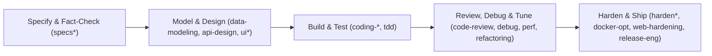

# Personal Skills for Coding Agents

A curated suite of **first-principles engineering skills** for AI coding agents across the full software lifecycle: pre-code specification and premise fact-checking, language-specific systems guidelines, data modeling, API and UI/CLI design, test-driven development, scientific debugging, performance engineering, brownfield refactoring, container and release engineering, host/service/supply-chain/binary security hardening, and plain-English technical documentation.

## Design Principles

- **Flat 1-level layout:** Every skill lives at `<skill-dir>/SKILL.md` (with optional `references/` and `scripts/` subdirectories), ready to symlink directly into `~/.gemini/config/skills/`, `~/.claude/skills/`, or `.agents/skills/`.
- **Modular subgroup isolation:** Multi-skill families (`specs*`, `coding-*`, `ui*`, `harden*`) route cleanly within their own family while standalone skills carry zero cross-skill coupling, so any individual skill or family installs independently.
- **Mechanical sympathy & minimalism:** Challenges unnecessary services, databases, frameworks, and dependencies first; pairs architectural guidelines with deterministic verification gates.

## Software Lifecycle Map

The diagram below shows how the skill families connect from problem framing through production operations.



*Figure 1: Each stage pairs first-principles constraints with deterministic verification before advancing.*

---

## Skill Catalog (47 Skills)

### 1. Pre-Code Engineering Synthesis (`specs` Suite — 11 Skills)

| Skill | Role & Scope |
| --- | --- |
| [specs](specs/SKILL.md) | Core router, traceability spine (`SPEC-NNNN`, `REQ-NNNN`, `INV-NNNN`, `ASM-NNNN`), and `Situate -> Plan -> Establish -> Code -> Solidify` protocol. |
| [specs-explore](specs-explore/SKILL.md) | Read-only thinking partner for framing problems, surveying prior art, and comparing design options. |
| [specs-discover](specs-discover/SKILL.md) | Evidence-based documentation gap analysis for undocumented or brownfield codebases. |
| [specs-grill](specs-grill/SKILL.md) | Adversarial load-bearing premise fact-checker and round-by-round design-tree frontier interview. |
| [specs-adr](specs-adr/SKILL.md) | Proportional MADR Architecture Decision Records (`ADR-NNNN`) with pre-draft research and critic/advocate council. |
| [specs-gtm](specs-gtm/SKILL.md) | Commercial, regulatory, privacy/AI-data-use, SPDX licensing, SLO, support, and App Store / Play Store readiness. |
| [specs-telemetry](specs-telemetry/SKILL.md) | Hardware-to-cloud observability: tokenized MCU `.noinit` rings, flash/battery budgets, PII-safe wide events, and traces. |
| [specs-tools](specs-tools/SKILL.md) | Deterministic module-boundary, AST, license, and migration guardrails, golden oracles, and cold-diff domain gates. |
| [specs-plan](specs-plan/SKILL.md) | Dependency-ordered task DAG (`PLAN-NNNN`) with acceptance criteria, verification commands, and Generator–Critic review. |
| [specs-implement](specs-implement/SKILL.md) | Parallel isolated-worktree task execution with vertical-slice red-green seam tests and cold-diff gates. |
| [specs-readability](specs-readability/SKILL.md) | Idiomatic readability, high-signal `"why"` comments, API contract docs, and governing-comment traceability review. |

### 2. Language & Platform Guidelines (`coding-*` Family — 6 Skills)

| Skill | Role & Scope |
| --- | --- |
| [coding-c](coding-c/SKILL.md) | C23 and embedded/HPC C-style C++: arena lifetimes, fixed-width bounds, UB/sanitizer gates, and ABI/ELF discipline. |
| [coding-go](coding-go/SKILL.md) | Go systems guidelines: goroutine lifecycle, escape/allocation control, HTTP/SSRF hardening, TinyGo, and WebAssembly. |
| [coding-kotlin](coding-kotlin/SKILL.md) | Kotlin 2.x (K2) & Android: pure `domain`/`commonMain` cores, Compose `60/120 Hz` skipping, Wear OS/tablets, R8, KeyMint, and JNI. |
| [coding-python](coding-python/SKILL.md) | CPython mechanical sympathy (`__slots__`, `memoryview`, vectorization), `uv` hash-locked supply chain, `TaskGroup`, and PyO3/WASI. |
| [coding-rust](coding-rust/SKILL.md) | Rust 2024 ownership, borrowed-view APIs, niche/cache layout, panic-free arithmetic, `unsafe`/Miri proofs, and Cargo supply chain. |
| [coding-ts](coding-ts/SKILL.md) | TypeScript `5.8+`: runtime boundary parsing, V8 monomorphic shapes, `AbortSignal`/`using`, barrel-free graphs, and mock-free tests. |

### 3. Architecture, Storage, APIs & Release Engineering (4 Skills)

| Skill | Role & Scope |
| --- | --- |
| [data-modeling](data-modeling/SKILL.md) | Files-first 5-rung storage escalation ladder (OS files $\to$ SQLite/DuckDB $\to$ PostgreSQL/ClickHouse), entity minimalism, and zero-downtime DDL. |
| [api-design](api-design/SKILL.md) | Two-horizon RFC 9457 errors for LLM self-correction with zero internal disclosure, strict unknown-field rejection, batching, and idempotency. |
| [docker-opt](docker-opt/SKILL.md) | Multi-stage Dockerfiles, minimal base images (`scratch`, Distroless, Wolfi, Chiseled), BuildKit caching, and runtime least privilege. |
| [release-engineering](release-engineering/SKILL.md) | Hermetic bit-for-bit reproducible builds, artifact size budgets, 4-rung CI/CD actuation ladder, canary physics, and sub-minute rollback. |

### 4. UI, CLI & Human-Factors Engineering (`ui` Suite — 8 Skills)

| Skill | Role & Scope |
| --- | --- |
| [ui](ui/SKILL.md) | Cross-stack UI architecture and diff-audit router across CLI, TUI, Desktop (Qt/GTK/WinUI/egui), Mobile (Compose/SwiftUI), and Web. |
| [ui-ergonomics](ui-ergonomics/SKILL.md) | Critical User Journeys (CUJs), Fitts's/Hick's/KLM-GOMS interaction budgets, addressable state, and Poka-Yoke mistake-proofing. |
| [ui-cli](ui-cli/SKILL.md) | Dual-audience human TTY vs. pipe/agent CLI design (`stdout` data vs. `stderr` diagnostics, `--json`/`--plain`, `--dry-run`, exit codes). |
| [ui-performance](ui-performance/SKILL.md) | `60/120 Hz` frame-budget engineering, `10^4–10^8` row virtualization, off-thread snapshots, stream conflation, and chart LOD decimation. |
| [ui-accessibility](ui-accessibility/SKILL.md) | Platform accessibility trees (`Name`, `Role`, `State`, `Actions`), 100% keyboard roving focus, modal containment, and WCAG 2.2 AA. |
| [ui-layout](ui-layout/SKILL.md) | Gestalt proximity ratios, low-noise containment, shared alignment axes, adaptive split panes, RTL mirroring, and string-growth resilience. |
| [ui-typography](ui-typography/SKILL.md) | Semantic type scales, tabular numerals (`tnum`), UTF-8/`NFC`/`UAX #29` grapheme safety, BiDi isolation, and copyable data text. |
| [ui-colors](ui-colors/SKILL.md) | Perceptual OKLCh/OKLab ramps, semantic/dataviz tokens, WCAG 2.2 + APCA contrast gates, and `scripts/oklch_palette.py` compile-time codegen. |

### 5. Verification, Debugging, Performance & Refactoring (5 Skills)

| Skill | Role & Scope |
| --- | --- |
| [tdd](tdd/SKILL.md) | Vertical-slice red-green-refactor loop at public module seams, golden-oracle tests, and anti-tautological assertions. |
| [code-review](code-review/SKILL.md) | Structural guardrail execution followed by parallel cold-diff specialist subagents across Correctness, Spec Conformance, Module Depth, and Domain Gates. |
| [debug](debug/SKILL.md) | Three-horizon defect prevention by construction, design for debuggability (`Clock`/`Rng` seams, `check_rep()`), and hypothesis-driven crash/race forensics. |
| [perf-engineering](perf-engineering/SKILL.md) | Speed-of-light & Amdahl/Roofline/USL bounds, CPU/off-CPU/PMU profiling, anti-gaming `ABBA` benchmarks, and open-loop load testing. |
| [refactoring](refactoring/SKILL.md) | Brownfield Behavioral Contract Ledger (Hyrum's Law), boundary characterization + sabotage gate, module deepening, Mikado Method, and Strangler Fig. |

### 6. Security & Infrastructure Hardening (`harden` Suite + Web — 10 Skills)

| Skill | Role & Scope |
| --- | --- |
| [harden](harden/SKILL.md) | Core security hardening router, risk model, and lockout-safe timed-rollback change protocol for hosts, containers, services, and builds. |
| [harden-audit](harden-audit/SKILL.md) | Read-only Linux/container/ELF attack-surface collector (`scripts/audit.sh`), IPv4/IPv6 outside-in port scan workflow, and compromise triage. |
| [harden-host](harden-host/SKILL.md) | Linux OS baseline: package/service minimization, unattended updates, sudo, sysctl/cmdline, mounts, systemd sandboxing, and auditd. |
| [harden-ssh](harden-ssh/SKILL.md) | OpenSSH & Dropbear hardening: key-only/FIDO2/certificate auth, `PerSourcePenalties`, subtractive post-quantum crypto, and dead-man rollout. |
| [harden-firewall](harden-firewall/SKILL.md) | `inet` nftables at IPv4/IPv6 parity, Docker published-port bypass defense (`docker_guard.nft` & `DOCKER-USER`), ICMPv6, and kernel rate meters. |
| [harden-docker](harden-docker/SKILL.md) | Daemon loopback publish defaults, rootless/userns trade-offs, `read_only` + `cap_drop: ALL`, internal Compose networks, and scratch images. |
| [harden-services](harden-services/SKILL.md) | Hardening Redis/Valkey, PostgreSQL, MySQL/MariaDB, MongoDB, Elasticsearch, message brokers, admin UIs, and nginx/Caddy TLS proxies. |
| [harden-supply-chain](harden-supply-chain/SKILL.md) | Per-repo `Signed-By` APT/RPM pinning, verified binary downloads, hash-locked/cooled language deps, cosign/SLSA, and GitHub Actions hardening. |
| [harden-build](harden-build/SKILL.md) | Production ELF mitigations (`PIE`, Full `RELRO`, `FORTIFY=3`, `CET`/`PAC+BTI`, LTO `CFI`), `scripts/check-elf.sh`, fuzzing, MC/DC, mutation, and formal proofs. |
| [web-hardening](web-hardening/SKILL.md) | Centralized HTTP security headers, session-bound CSRF with explicit exemption tables, hash-allowlisted CSP + Trusted Types, XSSI, and BREACH scoping. |

### 7. Technical Writing & Domain Reference Tools (3 Skills)

| Skill | Role & Scope |
| --- | --- |
| [writing-tech-docs](writing-tech-docs/SKILL.md) | 32 numbered rules (`R1`–`R32`) for decision docs (specs, ADRs, RFCs) and developer/operator docs (READMEs, runbooks, references), plus `scripts/doc_lint.py`. |
| [schwab-api](schwab-api/SKILL.md) | Three-legged OAuth 2.0, account/order REST endpoints, WebSocket streaming, and TypeScript schemas for the Charles Schwab Trading API. |

---

## Installation

Symlink the repository (or individual `<skill-dir>/` folders) into your agent harness's skills directory:

```bash
# Antigravity / Gemini CLI
ln -s /path/to/skills ~/.gemini/config/skills

# Claude Code
ln -s /path/to/skills ~/.claude/skills
```

## Bundled Verification Scripts

Several skills include zero-dependency CLI tools for deterministic verification:

| Script | Purpose |
| --- | --- |
| [writing-tech-docs/scripts/doc_lint.py](writing-tech-docs/scripts/doc_lint.py) | Lints Markdown against measurable `R1`–`R32` prose/table/code/link rules and `--compare ORIG REVISED` preservation limits. |
| [ui-colors/scripts/oklch_palette.py](ui-colors/scripts/oklch_palette.py) | Generates perceptual OKLCh ramps, verifies WCAG 2.2 + APCA contrast & sRGB gamut clamping, and emits Rust/C++/Go/CSS constants. |
| [harden-audit/scripts/audit.sh](harden-audit/scripts/audit.sh) | Read-only Linux host, listener, firewall, sshd, sysctl, SUID, ELF mitigation, and Docker security evidence collector (`--deep` optional). |
| [harden-build/scripts/check-elf.sh](harden-build/scripts/check-elf.sh) | Audits ELF binaries and shared libraries for `PIE`, Full `RELRO`, `NX`, `FORTIFY`, `CET`/`PAC+BTI`, `CFI`, and leaked sanitizer runtimes. |
