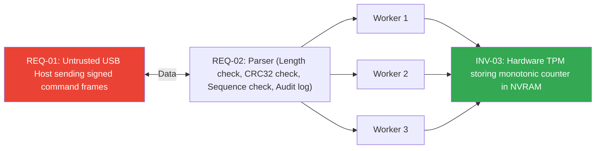
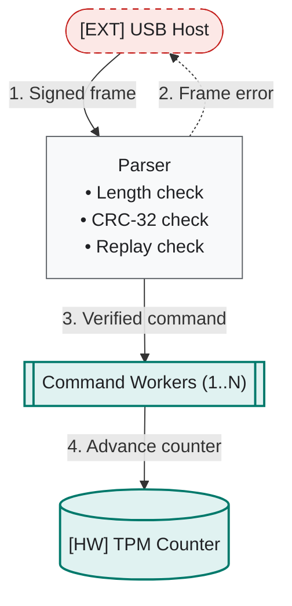

# Diagram patterns, palettes, and Google Docs setup

This reference covers portable source-backed diagram workflows in Markdown and
Google Docs, the red-green-safe semantic palette (D10), and a before-and-after
Mermaid example.

## Markdown and Google Docs workflows

Google Docs has no built-in Mermaid or Graphviz parser, and hosted third-party
add-ons send private document text to external servers. Use one of these 2
portable, source-backed workflows instead:

### Inline Markdown (GitHub, GitLab, and static sites)

1.  **Embed fenced blocks directly:** Place plain `mermaid` or `dot` fenced
    blocks inside the Markdown file so diffs stay reviewable in version control.
2.  **Validate before commit:** Run `diagram_lint.py` on the Markdown file to
    check node counts, arrow counts, label lengths, and palette rules.

### Local rendering and Alt-text storage for Google Docs

Render each Mermaid or DOT file locally to an opaque-white PNG, then insert it
into Google Docs:

```bash
# Render Mermaid (@mermaid-js/mermaid-cli) at 2x scale on opaque white
mmdc -i diagram.mmd -o diagram.png -s 2 -b white

# Render Graphviz DOT at 200 DPI on opaque white
dot -Tpng -Gdpi=200 -Gbgcolor=white diagram.dot -o diagram.png
```

1.  **Insert the rendered PNG:** Place `diagram.png` below its lead-in sentence
    (`<= 450 pt` wide) via the Google Docs UI or Google Docs API.
2.  **Store editable source in Alt text:** Open "Alt text" (or image properties
    via API), set "Title" to "MERMAID" or "DOT", and paste the source into
    "Description".
3.  **Quote special characters in labels:** Wrap Mermaid node labels containing
    slashes, colons, parentheses, or brackets in double quotes
    (`K["[K] Keyring (0..N)"]`). Write edge labels in pipe syntax
    (`A -->|"1. Verify token"| B`) so Markdown and CLI renderers parse
    punctuation reliably.

## Red-green-safe semantic palette (D10)

Table 1 lists 5 red-green-safe pastel categories (from Okabe and Ito 2008,
lightened for `#202124` text at `>= 4.5:1` contrast) and one neutral fill.

Category role                   | Fill hex  | Stroke hex | Non-color cue examples
------------------------------- | --------- | ---------- | ----------------------
Primary tier or kernel          | `#E8F0FE` | `#1967D2`  | `subgraph Kernel` or `[K]` prefix
Trusted, verified, or safe      | `#E0F2F1` | `#00796B`  | Solid thick border (`2px`) or `[T]`
Untrusted, external, or error   | `#FCE8E6` | `#C5221F`  | Dashed border (`5 5`) or `[EXT]`
Userland, client, or warning    | `#FEF7E0` | `#E37400`  | Stadium shape `([...])` or `[APP]`
Hardware, enclave, or key store | `#F3E8FD` | `#8430CE`  | Cylinder `[("...")]` or `[HW]` prefix
Neutral context or unchanged    | `#F8F9FA` | `#5F6368`  | Standard rectangle

*Table 1: Pair each active category with a redundant boundary, border, shape, or
`[TAG]` cue on the same category.*

## Before and after example

Counterexample breaking D3 to D10 (`LR` sprawl, `<-->` edge, vague "Data" label,
inline IDs and commas, 3 duplicate workers, and raw red-green fills):

<!-- diagram-lint: off -->



<!-- diagram-lint: on -->

Figure 1 applies D3 to D10 with a top-down spine, numbered arrows, vertical `• `
sub-items, `(1..N)` multiplicity, and 2 semantic fills beside a neutral node:



*Figure 1: Every untrusted USB frame passes parser checks before any verified
worker advances the hardware counter.*

Legend: Solid arrows are synchronous calls and dashed arrows are error replies.
Dashed vermilion `[EXT]` is untrusted input, gray is the parser, and thick
teal-green marks verified workers and `[HW]` storage.

The numbered steps below give the contracts for the 4 arrows in Figure 1:

1.  **Signed frame:** The external USB host sends a command header and payload
    over bulk endpoint 1 (untrusted boundary).
2.  **Frame error:** If length, CRC-32, or sequence checks fail, the parser
    drops the payload and returns an error code (`ERR_FRAME_LEN`, for example).
3.  **Verified command:** The parser dispatches valid frames across the pool of
    1 to 4 command workers (`Command Workers (1..N)`).
4.  **Advance counter:** The active worker increments the monotonic counter in
    hardware NVRAM (`INV-01 (counter order)`) before executing the state change.
