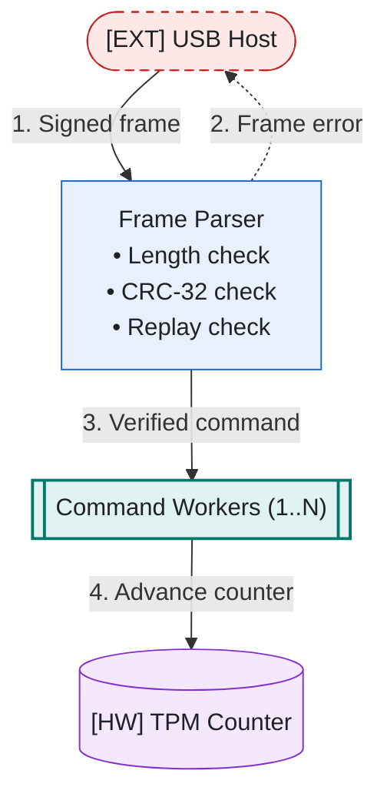

# Diagram patterns, palettes, and Google Docs setup

Use this reference alongside the skill rules (D1 to D10) for Markdown and
Google Docs delivery. It also provides Mermaid and Graphviz DOT palettes and
worked examples.

## Markdown and Google Docs workflows

Keep diagram source in version control alongside Markdown whenever possible.
Google Docs has no built-in Mermaid or Graphviz parser, and pasting private
designs into hosted third-party add-ons sends text to external servers. Use one
of these 2 portable, source-backed workflows instead:

### Inline Markdown (GitHub, GitLab, and static sites)

1.  **Embed fenced blocks directly:** Place plain `mermaid` or `dot` fenced
    blocks directly inside the Markdown file so diffs stay reviewable in VCS.
2.  **Validate before commit:** Run `diagram_lint.py` on the `.md` file to check
    node counts, arrow counts, label lengths, and palette rules.

### Local rendering for Google Docs

Render each `.mmd` or `.dot` file locally to a high-DPI PNG, then insert it into
Google Docs. The commands below show both local renderers:

```bash
# Render Mermaid with mermaid-cli (@mermaid-js/mermaid-cli) at 2x scale
mmdc -i diagram.mmd -o diagram.png -s 2 -b white

# Render Graphviz DOT at 200 DPI
dot -Tpng -Gdpi=200 diagram.dot -o diagram.png
```

1.  **Insert the rendered PNG:** Upload `diagram.png` below its lead-in sentence
    in Google Docs, and keep its width within the page (`<= 450 pt`).
2.  **Store the source in Alt text:** Right-click the image, open "Alt text",
    set "Title" to `MERMAID` or `DOT`, and paste the full source into
    "Description".
3.  **Update in place later:** Copy the source from Alt text or VCS, edit it,
    re-render `diagram.png`, replace the image, and update Alt text.

Wrap any Mermaid node label that contains slashes, colons, parentheses, or
brackets in double quotes, such as `K["[K] Keyring (0..N)"]`. Write edge labels
in pipe syntax, such as `A -->|"1. Verify token"| B`, so Markdown and CLI
renderers parse punctuation reliably.

## Red-green-safe semantic palette (D10)

Table 1 lists 5 deuteranopia- and protanopia-safe pastel categories (from Okabe
and Ito 2008, lightened for `#202124` text at `>= 4.5:1` contrast) and one
neutral fill. Select 3 to 5 categories per diagram and pair each with a
non-color cue.

Category role                   | Fill hex  | Stroke hex | Non-color cue examples
------------------------------- | --------- | ---------- | ----------------------
Primary tier or kernel          | `#E8F0FE` | `#1967D2`  | `subgraph Kernel` or `[K]` prefix
Trusted, verified, or safe      | `#E0F2F1` | `#00796B`  | Solid thick border (`2px`) or `[T]`
Untrusted, external, or error   | `#FCE8E6` | `#C5221F`  | Dashed border (`5 5`) or `[EXT]`
Userland, client, or warning    | `#FEF7E0` | `#E37400`  | Stadium shape `([...])` or `[APP]`
Hardware, enclave, or key store | `#F3E8FD` | `#8430CE`  | Cylinder `[("...")]` or `[HW]` prefix
Neutral context node            | `#F8F9FA` | `#5F6368`  | Standard rectangle

*Table 1: Teal-green (`#E0F2F1`) and vermilion-red (`#FCE8E6`) preserve
trusted-against-untrusted intuition while staying distinct under red-green
colorblindness.*

The snippet below defines reusable Mermaid `classDef` styles from Table 1:

```text
classDef trusted fill:#E0F2F1,stroke:#00796B,stroke-width:2px,color:#202124
classDef ext fill:#FCE8E6,stroke:#C5221F,stroke-dasharray:5 5,color:#202124
classDef kernel fill:#E8F0FE,stroke:#1967D2,color:#202124
classDef hw fill:#F3E8FD,stroke:#8430CE,color:#202124
```

## Before and after example

The draft below breaks rules D3 to D10. It uses branched `LR` flow and crams IDs
and a comma-separated list into boxes. It also duplicates 3 worker boxes and
pairs raw green with raw red:

```text
flowchart LR
  USB["REQ-01: Untrusted USB Host sending signed command frames"]
  P["REQ-02: Parser (Length check, CRC32 check, Sequence check, Audit log)"]
  W1["Worker 1"] & W2["Worker 2"] & W3["Worker 3"]
  TPM["INV-03: Hardware TPM storing monotonic counter in NVRAM"]
  USB -->|"Raw USB packet with header and payload"| P
  P --> W1 & W2 & W3
  W1 & W2 & W3 --> TPM
  style TPM fill:#34A853,color:#fff
  style USB fill:#EA4335,color:#fff
```

Figure 1 applies rules D3 to D10. It uses top-down flow, 4 boxes with numbered
arrows, 1-to-3-word ID-free labels, vertical `• ` sub-items, and `(1..N)`
multiplicity. Teal-green against vermilion-red pastels pair with dashed borders,
`[EXT]` and `[HW]` prefixes, a legend, and a keyed list below.



Legend: Solid arrows are synchronous calls, and dashed arrows are error replies.
Dashed red `[EXT]` is untrusted input, blue is kernel, thick teal-green is
verified execution, and purple `[HW]` cylinder is hardware storage.

*Figure 1: Every untrusted USB frame passes kernel parsing before any worker
touches the hardware counter.*

The numbered steps below give the contracts for the 4 arrows in Figure 1:

1.  **Signed frame:** The external USB host sends a command header and payload
    over bulk endpoint 1 (untrusted boundary).
2.  **Frame error:** If length, CRC-32, or sequence checks fail, the kernel
    parser drops the payload and returns an error code (`ERR_FRAME_LEN`, for
    example).
3.  **Verified command:** The parser dispatches valid frames across the pool of
    1 to 4 command workers (`Command Workers (1..N)`).
4.  **Advance counter:** The active worker increments the monotonic counter in
    hardware NVRAM (`INV-01. Counter order`) before executing the state change.
